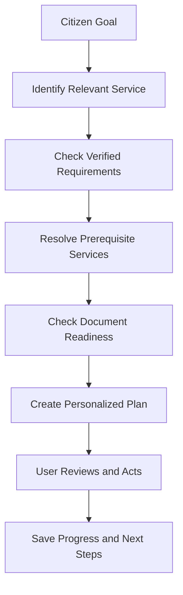
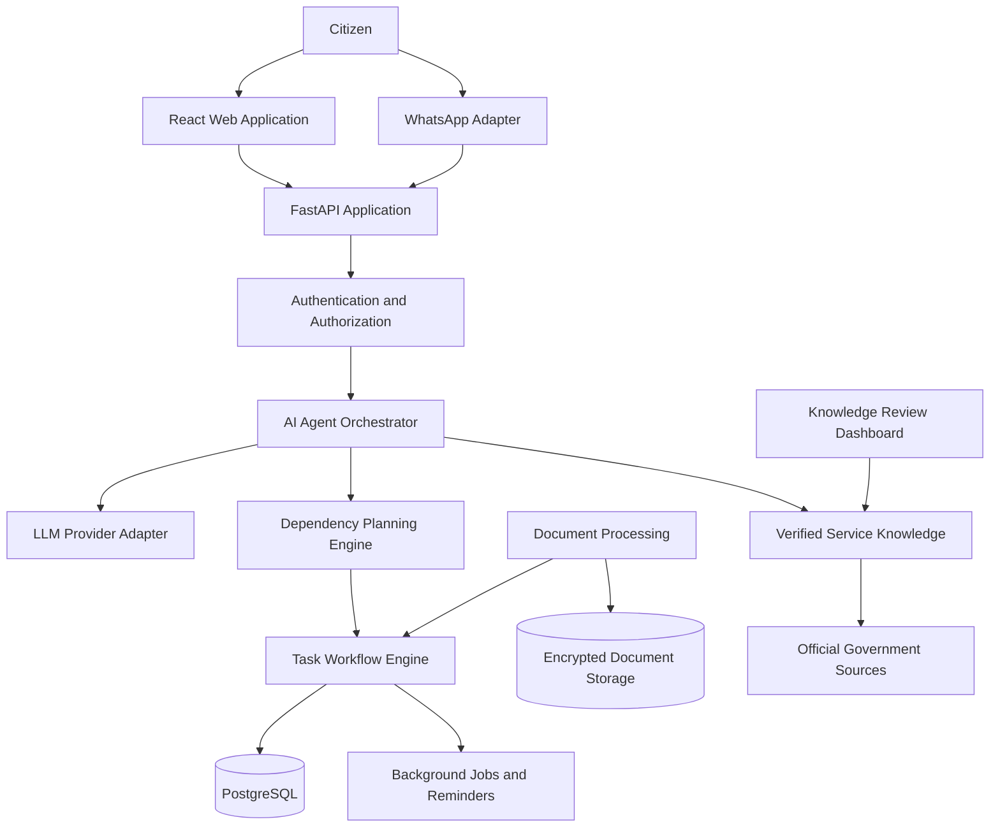

# 🇮🇳 Namma Seva Agent AI

<h3 align="center">One Nation. One Intelligent Assistant. Easier Access to Public Services.</h3>

<p align="center">
  <b>A Tamil-first AI agent transforming how citizens discover, understand, and navigate government services.</b>
</p>

<p align="center">
  <a href="https://github.com/nanthishvaran17/namma-seva-agent">
    
  </a>
  
  
  
  
</p>

<p align="center">
  <a href="#-the-vision">Vision</a> ·
  <a href="#-why-namma-seva">Why Namma Seva</a> ·
  <a href="#-capabilities">Capabilities</a> ·
  <a href="#-architecture">Architecture</a> ·
  <a href="#-technology">Technology</a> ·
  <a href="#-roadmap">Roadmap</a> ·
  <a href="#-contributing">Contributing</a>
</p>

---

## 🌟 The Vision

**Government services should be understandable to everyone—not just people who know how to navigate complicated websites.**

Namma Seva Agent AI is an AI-powered civic technology platform designed to help people navigate Tamil Nadu government services through a single, conversational, Tamil-first interface.

From finding a relevant certificate to understanding scholarship requirements, organizing documents, and planning application steps, Namma Seva aims to make public-service navigation simpler and more accessible.

Instead of leaving citizens with a list of links, the platform is designed to help them understand **what to do, why it matters, what is missing, and what comes next.**

> **Our mission:** Make government-service information easier to understand and government-service workflows easier to navigate, regardless of language or digital experience.

---

## 🎯 Why Namma Seva?

Citizens may encounter a fragmented experience when trying to access government services.

| Challenge | Our approach |
|---|---|
| Information spread across multiple portals | Unified service discovery |
| Complicated eligibility requirements | Clear, source-grounded explanations |
| Unclear document requirements | Personalized document checklists |
| Multiple prerequisite certificates | Dependency-aware planning |
| Difficult application workflows | Step-by-step guided assistance |
| Language and digital-literacy barriers | Tamil, Tanglish, and English support |
| Forgotten follow-up actions | Persistent tasks and reminders |
| Uncertain or outdated information | Source verification and transparent uncertainty |

Our goal is not to replace official government portals. It is to make them easier for citizens to understand and navigate.

## 💎 What Makes It Different?

### From answering questions to helping people complete tasks

A conventional chatbot might explain a scholarship.

Namma Seva is designed to help the user:

1. Understand the scholarship requirements.
2. Identify applicable prerequisite certificates.
3. Check which documents are available.
4. Identify missing information.
5. Prepare a personalized checklist.
6. Follow the official application process.
7. Record progress and plan the next action.

This task-oriented approach is the foundation of the product.

**The differentiator is the combination of verified knowledge, dependency planning, document readiness, and persistent follow-through—not simply the use of an LLM.**

---

## 🚀 Capabilities

### 🤖 01 — Conversational AI Agent

Interact naturally instead of navigating complex menus.

- Tamil, Tanglish, and English input.
- Intent recognition and clarifying questions.
- Context-aware service discovery.
- Tool-assisted planning.
- Source-grounded answers.
- Honest fallback when information is missing.

### 🏛️ 02 — Government Service Intelligence

Build a structured, searchable catalog of verified government services.

Candidate categories include:

- Community, income, and nativity certificates.
- Student scholarships and educational assistance.
- Employment-related services.
- Agricultural and farmer welfare services.
- Pensions and social welfare.
- Ration-card services.
- Land and property records.
- Women and child welfare.
- Disability-related services.
- Local-body services.

Every published service should carry its official sources, verification status, and relevant update history.

### 🧠 03 — Dependency-Aware Planning

Government-service workflows can involve multiple prerequisites.

The planning engine resolves dependencies and creates an ordered action plan using structured, reviewed rules.



Dependency resolution must be deterministic, validated, and cycle-aware. The LLM explains the plan but does not invent the underlying rules.

### 📄 04 — Document Intelligence

Help citizens organize the information required for an application.

Planned capabilities include:

- Secure document uploads.
- OCR-based extraction.
- Document classification.
- User-reviewed extracted fields.
- Missing-document detection.
- Document readiness reports.
- Form-ready information.
- Supported PDF generation.

Automated extraction is assistance, not official verification of a document's authenticity.

### 📌 05 — Application Journey Management

Turn a service request into a manageable task.

```text
Discover
   ↓
Understand Requirements
   ↓
Prepare Documents
   ↓
Review Application Information
   ↓
Follow Official Submission Steps
   ↓
Track Supported Status Information
   ↓
Identify the Next Action
```

The platform records user progress without falsely claiming that an official application was submitted, approved, or completed.

### 🔔 06 — Reminders and Follow-Through

Planned reminders for missing documents, incomplete tasks, user-configured deadlines, and follow-up actions.

Official deadlines must be grounded in verified sources. Personal reminders must be clearly distinguished from government deadlines.

### 🗣️ 07 — Tamil-First Accessibility

Design the experience around real users, including people who are less comfortable with English or complicated digital interfaces.

- Simple Tamil explanations.
- Tanglish support.
- Responsive mobile interface.
- Clear action buttons.
- Accessible contrast and typography.
- Voice integration through a suitable provider when configured.
- Straightforward error recovery.

### 🛡️ 08 — Trust, Privacy, and Human Control

Trust is part of the architecture.

- Verified information and source provenance.
- Minimal collection of personal data.
- Secure document access.
- Explicit confirmation for consequential actions.
- No storage of user OTPs or passwords.
- No unsupported claims about application status.
- Human escalation for uncertain cases.
- Data export and deletion workflows.

---

## 🏗️ Architecture

Namma Seva is designed as a modular AI application with deterministic backend workflows.



### Architectural principles

| Principle | Implementation approach |
|---|---|
| Grounded answers | Approved sources and versioned playbooks |
| Deterministic workflows | Backend validation and state machines |
| Extensibility | Provider adapters and reusable playbooks |
| Privacy | Least privilege and minimal data collection |
| Reliability | Tests, validation, retries, and error handling |
| User control | Explicit confirmation for sensitive actions |

*This diagram describes the intended architecture; update it as the implementation evolves.*

---

## 🧰 Technology

<p align="center">
  
  
  
  
  
  
  
  
</p>

| Layer | Planned technology |
|---|---|
| Frontend | React, Vite, TypeScript |
| UI styling | Tailwind CSS |
| Backend | Python, FastAPI |
| Data validation | Pydantic |
| Database | PostgreSQL |
| ORM and migrations | SQLAlchemy, Alembic |
| AI orchestration | Provider-independent LLM adapter |
| Knowledge retrieval | Structured playbooks and RAG |
| Background processing | Redis and Celery |
| Document processing | OCR and PDF adapters |
| Messaging | WhatsApp Cloud API |
| Tamil voice | Bhashini / Sarvam adapters |
| Containerization | Docker |
| CI | GitHub Actions |
| Testing | Pytest and frontend test tools |

Provider selection, versions, and integration requirements should be verified during implementation.

---

## 📚 Verified Knowledge Architecture

Government-service information must be managed as structured, reviewable data.

Each service playbook should include:

- Service identifier and localized names.
- Responsible department.
- Eligibility rules.
- Required and optional documents.
- Official portal links.
- Application steps.
- Fees and processing times where verified.
- Prerequisite services.
- Official sources.
- Last verification date.
- Reviewer and version information.
- Publication status.

### Verification lifecycle

```text
Draft
  ↓
Source Collection
  ↓
Fact Verification
  ↓
Review and Approval
  ↓
Published Playbook
  ↓
Periodic Review
```

Unverified facts must remain explicitly marked. Missing information must not be invented to make a response look complete.

---

## 🔐 Security and Privacy

The platform is designed with a security-first approach.

- Authentication and object-level authorization.
- Secure document storage.
- Encryption in transit and appropriate encryption at rest.
- Secrets management.
- Input validation and rate limiting.
- Secure file-upload validation.
- PII-redacted logging.
- Prompt-injection defenses.
- Audit trails for sensitive actions.
- Consent, retention, export, and deletion controls.
- Dependency and vulnerability checks.

The system must never request a user's OTP for processing, bypass official portal security, or perform unauthorized submissions.

Applicable Indian privacy and data-protection obligations, including the DPDP Act and relevant rules, must be assessed before production deployment.

---

## 🗺️ Roadmap

The roadmap below represents intended development milestones, not a claim that every capability has already been delivered.

- [ ] **Foundation:** Repository, database, migrations, and playbook validation.
- [ ] **Planning Engine:** Service dependencies and deterministic action plans.
- [ ] **AI Orchestration:** LLM adapter, tool calling, and source-grounded responses.
- [ ] **Web Experience:** Responsive landing page, chat, catalog, and dashboard.
- [ ] **Task Workflows:** Persistent tasks, progress, and reminders.
- [ ] **Document Intelligence:** Secure uploads, OCR, and readiness checks.
- [ ] **Knowledge Administration:** Playbook editing, verification, and versioning.
- [ ] **WhatsApp:** Official messaging integration.
- [ ] **Tamil Voice:** Configured speech-to-text and text-to-speech.
- [ ] **Quality and Security:** Multilingual evaluation and threat-model testing.
- [ ] **Deployment:** CI, containerization, operational documentation, and production review.

---

## 🧪 Quality and Evaluation

The system should be evaluated against real usage scenarios rather than only whether the interface renders.

Testing priorities:

- Service retrieval accuracy.
- Source correctness.
- Eligibility-rule accuracy.
- Dependency-planning correctness.
- Tamil and Tanglish comprehension.
- Tool authorization.
- Task-state validation.
- Document-processing errors.
- Safe fallback behavior.
- Prompt-injection resistance.
- User-data isolation.

A multilingual evaluation suite should include at least 50 representative conversations before making strong quality claims.

Only publish test counts, coverage figures, and reliability metrics after obtaining actual results.

---

## 🚀 Getting Started

### Prerequisites

- Git
- Python 3.12 or a compatible supported version
- Node.js LTS
- PostgreSQL
- Docker and Docker Compose, recommended

### Clone the repository

```bash
git clone https://github.com/nanthishvaran17/namma-seva-agent.git
cd namma-seva-agent
```


### Configure the environment

Copy `.env.example` to `.env` and provide the local configuration required by the implemented application.

Never commit secrets or actual user documents.

### Install and run

Use the dependency-installation, database-migration, and startup commands documented in the current repository.

If Docker Compose is configured, use the documented Compose workflow.

**Note:** Keep these instructions synchronized with the actual implementation. Do not claim a setup command works until it has been tested.

---

## 🤝 Contributing

Contributions are welcome as the project develops.

Areas of contribution include:

- Tamil language quality.
- Verified service playbooks.
- AI evaluation.
- Accessibility.
- Frontend development.
- Backend development.
- Cybersecurity testing.
- Documentation.
- Testing and deployment automation.

When contributing service information, provide authoritative sources and verification dates.

For significant changes, discuss the proposed approach in an issue before opening a pull request.

## 🌍 Social Impact

Namma Seva Agent aims to contribute to more accessible digital public services.

Potential alignment:

- **SDG 9:** Industry, Innovation and Infrastructure.
- **SDG 10:** Reduced Inequalities.
- **SDG 16:** Peace, Justice and Strong Institutions.

These are intended areas of impact. Measurable outcomes should be reported only after a real pilot and appropriate evaluation.

## ⚖️ Disclaimer

Namma Seva Agent AI is an independent project unless an official partnership is explicitly established.

It provides guidance and application assistance. Government departments and official portals remain authoritative for eligibility, requirements, fees, deadlines, application decisions, and approval status.

## 📌 Project Status

**Development stage:** Update this section according to the current repository.

Distinguish implemented and tested features from planned, mocked, and unconfigured integrations.

---

<p align="center">
  <b>🇮🇳 Technology with a purpose. AI with responsibility.</b>
</p>

<p align="center">
  <b>Namma Seva Agent AI</b><br/>
  <i>Making public services easier to navigate, one citizen at a time.</i>
</p>
